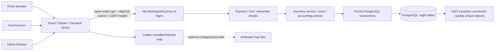
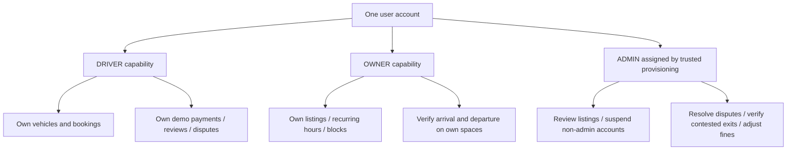

# Architecture and API

React Query caches server results and refreshes operational views. React Hook Form and Zod validate forms; backend Zod validation remains authoritative. Leaflet renders local markers and a static illustration by default. Nginx serves the production build and proxies the API and uploads through the same origin.

The API stores money in integer paise, never trusts browser totals, and reads time through `clock.ts`. Demo time advances only for an authenticated administrator outside production. Unit/integration tests freeze this clock exactly; local interactive demonstration time continues to advance naturally.

## Capabilities and ownership

Accounts always reload from PostgreSQL for authorization. Signed cookies contain only user ID, session version, CSRF nonce, issuer, audience and expiration. A suspension or logout increments `session_version`, invalidating existing sessions. Passwords use bcrypt (cost 12); neither hashes nor cookies are returned in user DTOs. Browser mutations require the configured Origin and a CSRF header matching the signed cookie nonce. Cookies are HttpOnly, SameSite=Lax and Secure in production. No wildcard credentialed CORS is enabled.

Express applies global and authentication rate limits, bounded request bodies, UUID/enum validation, Helmet, safe generic errors and ownership checks. File uploads are limited to 5 MB and JPEG/PNG/WebP signatures, receive random names and are served with `nosniff`. React escapes user content. SQL uses Prisma or tagged parameterized raw queries; no request input becomes SQL syntax. Production rejects the documented demo secret and disables time/reset/seed controls.

Public registration supports driver or driver+host, never administrator. An authenticated driver can enable hosting with `/auth/owner`. Listing permission confirmation and administrator approval are enforced on the server. Edits require reapproval, while existing bookings retain snapshotted price and access instructions.

## REST API reference

All paths below start with `/api`. Mutations use JSON unless stated. Authentication is required except config, health, public spots and sign-in/register. Errors use `{error, details?}` with HTTP 400, 401, 403, 404 or 409. Unexpected failures return 500 without internal diagnostics.

| Method       | Path                                     | Behavior                                                                |
| ------------ | ---------------------------------------- | ----------------------------------------------------------------------- |
| GET          | `/health`, `/config`                     | Database readiness; server time, demo mode and policies                 |
| POST         | `/auth/register`, `/auth/login`          | Create/sign in; issue signed cookie and CSRF nonce                      |
| GET          | `/auth/me`                               | Safe current user and CSRF nonce                                        |
| POST         | `/auth/logout`, `/auth/owner`            | Invalidate sessions; enable host capability                             |
| GET/POST     | `/vehicles`                              | Own active vehicles; add vehicle                                        |
| PATCH/DELETE | `/vehicles/:id`                          | Own vehicle edit; soft removal                                          |
| GET          | `/spots`                                 | Location, vehicle, price, interval and availability filtering; distance |
| GET          | `/spots/:id`                             | Public approved details; own/admin pending details                      |
| POST/PATCH   | `/spots`, `/spots/:id`                   | Host creates/edits own listing; approval becomes pending                |
| GET          | `/owner/spots`                           | Own spaces, schedules and blocks                                        |
| POST         | `/uploads`                               | Host image upload; multipart field `image`                              |
| PUT          | `/spots/:id/availability`                | Replace own recurring windows without invalidating reservations         |
| POST         | `/spots/:id/blocks`                      | Preview affected IDs on 409; explicit full-refund resolution            |
| DELETE       | `/spots/:id/blocks/:blockId`             | Own interval release and waiter notifications                           |
| GET/POST     | `/bookings`                              | Own bookings, or `?scope=owner`; create hold/wait entry                 |
| GET          | `/bookings/:id`                          | Driver, owning host or administrator only                               |
| POST         | `/bookings/:id/pay`                      | Validate hold/finalized fine and record idempotent demo payment         |
| POST         | `/bookings/:id/cancel`                   | Policy fee/refund and safe release                                      |
| POST         | `/bookings/:id/accept`                   | Try converting own WAITLISTED row into a real hold                      |
| POST         | `/bookings/:id/actions/arrival-request`  | Driver asks host to verify arrival                                      |
| POST         | `/bookings/:id/actions/check-in`         | Host/admin physically verifies arrival                                  |
| POST         | `/bookings/:id/actions/request-checkout` | Driver request; occupancy remains; delayed-confirmation fine cap        |
| POST         | `/bookings/:id/actions/confirm-checkout` | Host/admin verifies departure and finalizes fine                        |
| POST         | `/bookings/:id/actions/no-show`          | Host verifies absence after grace; auditable and disputable             |
| POST         | `/bookings/:id/actions/dispute`          | Driver opens dispute and freezes fine accumulation                      |
| POST         | `/bookings/:id/actions/respond-dispute`  | Host records evidence/response                                          |
| POST         | `/bookings/:id/actions/resolve`          | Admin resolves/waives/adjusts; can verify contested exit                |
| POST         | `/bookings/:id/review`                   | Driver reviews one own completed booking                                |
| GET          | `/payments`                              | Own ledger, or `?scope=owner` for space earnings                        |
| GET/POST     | `/notifications`, `/notifications/read`  | In-app notices; mark persisted notices read                             |
| GET          | `/admin/overview`                        | Safe users, listings, bookings, payments and statistics                 |
| POST         | `/admin/spots/:id`                       | Approve/reject with audit reason                                        |
| POST         | `/admin/users/:id`                       | Suspend/restore non-admin account with reason                           |
| POST         | `/demo/clock`                            | Admin only, non-production DEMO_MODE only                               |

Reservation body: `{parkingSpotId,vehicleId,startTime,endTime,idempotencyKey,waitlist?}`. Dates are ISO-8601 timestamps with explicit offset. Payment body: `{idempotencyKey,method,outcome,type}`; methods are `DEMO_UPI`, `DEMO_CARD`, `DEMO_CASH`; outcomes `success` or `failure`; type `BOOKING` or `OVERSTAY_FINE`. Unknown properties such as `amount` are rejected.

Block resolution body adds `resolveBookings:true` and the exact affected booking IDs returned by the initial preview. The transaction re-reads them under lock, so a stale confirmation cannot silently cancel a newly affected reservation.

Fine resolutions require an explanation. Changing a paid fine may only reduce it; a negative refund returns the paid difference. The zero-value adjustment plus booking audit records the decision without counting a receivable as cash revenue.
