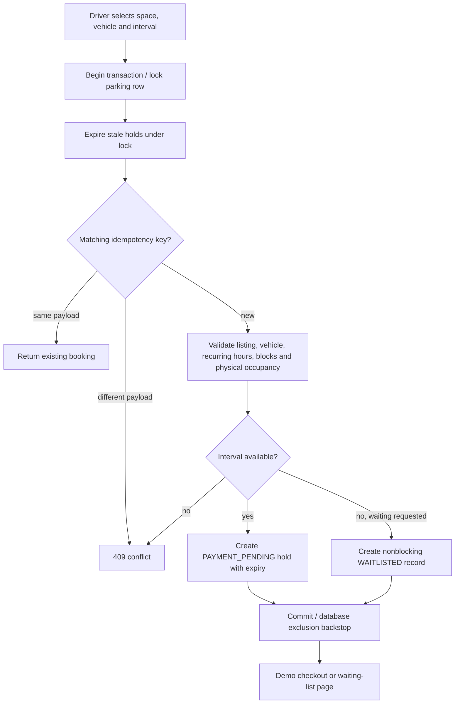
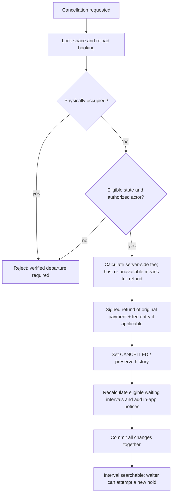
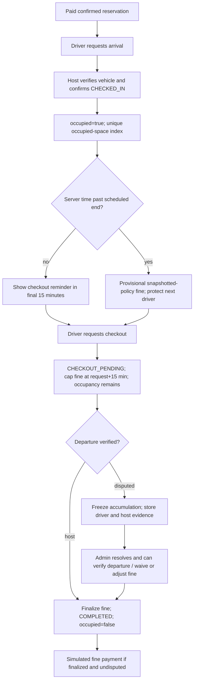

# Booking, payment and physical occupancy

## Reservation flow



## Payment flow

```mermaid
sequenceDiagram
  actor Driver
  participant API
  participant DB as PostgreSQL
  Driver->>API: Method + outcome + idempotency key (no amount)
  API->>DB: Begin; lock space; reload booking
  API->>DB: Check prior key and validate payload
  alt key already processed
    DB-->>API: Existing payment and current booking
  else new success with valid unexpired hold
    API->>DB: Insert SUCCESS demo ledger entry
    API->>DB: Set booking CONFIRMED and payment SUCCESS
    API->>DB: Commit both changes
  else simulated failure with valid hold
    API->>DB: Insert FAILED attempt; keep original hold deadline
    API->>DB: Commit
  else expired or invalid booking
    API-->>Driver: 409; reserve again
  end
  API-->>Driver: Explicitly simulated result
```

Failures count as attempts, not revenue. Double submissions under the same key return one record. A different key cannot create another successful booking charge because both state validation and a partial unique index prevent it. Fine payments require a completed session with a finalized undisputed outstanding fine.

## Cancellation flow



For an owner block, the first attempt returns affected IDs and times. The UI requires an explicit full-refund confirmation with those IDs. The transaction locks and revalidates the exact affected set, cancels those unoccupied bookings, and creates the block. Waiters are not told the newly blocked interval is available.

## Overstay and fine handling



If a booking is followed by another, the next driver receives an in-app unavailable-space warning while the previous occupant is overdue. Checking in is forbidden until physical exit is verified. The next driver may cancel for a full simulated refund, regardless of the normal late-cancellation fee.

The browser cannot declare that a vehicle has departed. A driver checkout request or dispute freezes/caps financial exposure under the documented policy but leaves physical occupancy unchanged. No-show handling similarly requires an owning host/admin to verify actual absence after the arrival grace period; absence is not inferred automatically.
