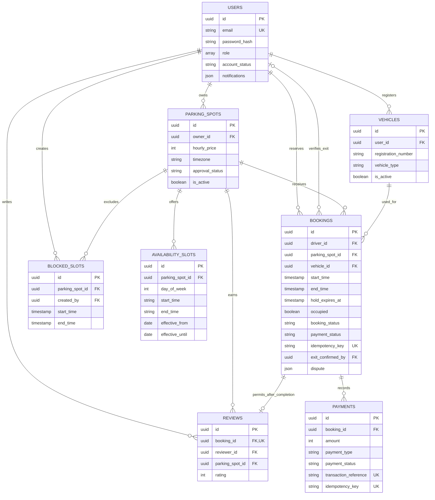

# Eight-table entity relationship diagram

All relationships restrict historical deletion. The optional `exit_confirmed_by` foreign key is added by raw SQL. Its SQL constraint remains part of the committed migration even though it is not a Prisma navigation relation. Prisma migration metadata is excluded from this business ER diagram.
